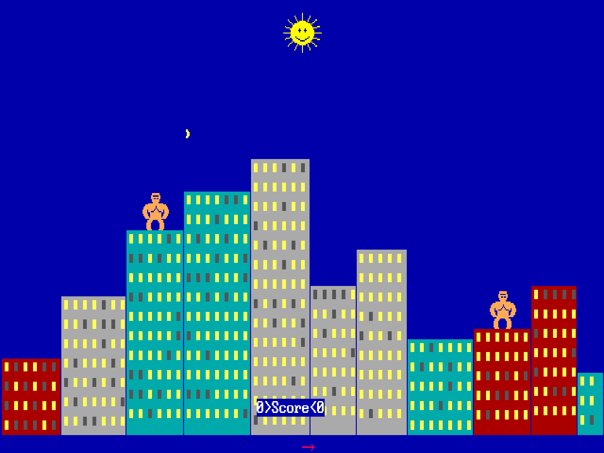

# GORILLAS.RS

Because someone had to do it: [QBasic Gorillas](https://en.wikipedia.org/wiki/Gorillas_(video_game)), the 1991 IBM classic where two gorillas fling exploding bananas across a city skyline, reimplemented in Rust.



The original and very vintage [`GORILLAS.BAS`](GORILLAS.BAS) is bundled in this repo.

**Play it in the browser:** <https://sunsided.github.io/gorillas.rs/>

## How it works

This is not a remake that looks like Gorillas: it is GORILLAS.BAS itself, ported statement by
statement ([`src/gorillas.rs`](src/gorillas.rs)), running on an emulated VGA card and PC
speaker from [game-toolkit-dosvideo](https://github.com/sunsided/game-toolkit-dosvideo).
Underneath sits a small QBasic runtime ([`src/qb.rs`](src/qb.rs)) with the statements the game
uses, quirks included:

- `LINE`, `CIRCLE` and `PAINT` draw the pixels QBasic draws. `CIRCLE` is GW-BASIC's
  half-pixel algorithm with an 8.8 fixed-point aspect ratio (which is why the gorilla
  explosion's aspect of -1.57 comes out flat), arcs are cut by point count, not angle.
- `RND` and `RANDOMIZE` are QBasic's 24-bit generator: with the same seed, the port builds the
  same city, wind and gorilla positions as QBasic.
- `PLAY` keeps tempo, octave and length from one statement to the next, buffers background
  music and blocks when the buffer is full, which is what paces the gorilla intro dance.
- Text uses the VGA BIOS fonts, 8x14 in `SCREEN 9` and 8x16 in text mode.
- Time is the emulated machine's: `Rest` busy-waits on the 18.2 Hz `TIMER` like the original,
  calibrated against QBasic 1.1 in DOSBox-X at 3000 cycles.

The program runs as an `async fn` polled by the host loop, so BASIC's blocking loops
(`INKEY$` polls, `TIMER` waits, `PLAY` in the foreground) stay blocking loops in the port.

### Checked against the original

[`tools/dosbox`](tools/dosbox) plays the same scripted session in QBasic under DOSBox-X and in
the port (`task compare`), with `RANDOMIZE 42` on both sides, and diffs the screenshots: the
intro, the input screens, the city, the sun, the gorillas and the explosions match pixel for
pixel. Animation timing matches within a few frames; the PC speaker uses the same notes, its
timing drifts a little.

## Running

```sh
cargo run --release
```

`Alt+C` cycles the CRT filters (it starts on the soft glow), `Alt+Enter` toggles fullscreen.
`GORILLAS_SEED=n` replaces `RANDOMIZE (TIMER)` with `RANDOMIZE n`; `GORILLAS_CRT=0..6` picks the
filter (0 = sharp pixels).

`gorillas capture TIMELINE OUTDIR [--frames]` runs a scripted session headless and writes
screenshots, a frame sequence and the speaker as WAV.

### In the browser

The web version is a SvelteKit page around the wasm build (Yarn via Corepack, wasm-pack):

```sh
task web          # build the wasm and serve with live reload
task web:build    # static site in web/build
```

GitHub Pages deploys from `main` through [`.github/workflows/pages.yml`](.github/workflows/pages.yml).

## Notes

[`docs/UPSTREAM.md`](docs/UPSTREAM.md) collects what this port had to build that belongs in
game-toolkit-dosvideo.

## License

EUPL-1.2, except the font files in [`fonts/`](fonts): the VGA BIOS character sets as DOSBox-X
provides them, dumped through the `INT 43h` vector, under GPL-2.0-or-later (see
[`fonts/README.md`](fonts/README.md)).
